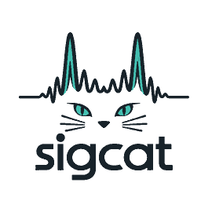

# SigCat 🐈 📡

  

**Local-first, open-source radio signal discovery and analysis.**

SigCat aims to turn permitted radio-frequency activity into a **searchable history of observations**: live spectrum, automatic activity detection, measured signal characteristics, verified protocol decodes, selected recordings, and optionally local speech transcription and translation.

Designed to run **headlessly on a Linux box** with an RTL-SDR or other compatible receiver. Open the web UI on that computer, another machine on your LAN, or privately over **Tailscale**. No public cloud is required for normal operation.

> **Project status: specification / pre-implementation.** The repository currently contains the requirements and development guidance. There is **no working Docker image, receiver, user interface or command-line application yet**. See the [full product requirements document](docs/PRD.md) for what will be built.

## What we're building

- **Discover:** receive IQ samples, show live FFT/waterfall, scan nominated bands, identify likely signal events and show actual receiver coverage gaps.
- **Understand:** conservatively estimate characteristics/modulation, run suitable open protocol decoders, and distinguish hypotheses from verified decodes.
- **Remember:** index structured observations, frequency/time ranges, decoder payloads, tags and permitted transcripts using SQLite + FTS5.
- **Investigate:** open a detailed event, examine its measurements and provenance, replay selected SigMF IQ or audio, annotate and export.
- **Listen locally where authorised:** VAD, offline ASR and optional translation via swappable model backends; model benchmarking on real RF audio.
- **Self-host privately:** Docker Compose on Linux, Axum/HTMX browser UI, loopback by default, optional LAN access, and Tailscale Serve for tailnet-only HTTPS.

SigCat is a **receive-only** project. It does not transmit, bypass encryption or access controls, promise to decode every signal, or grant permission to capture private communications. Audio recording and transcription are planned to be **off by default** and require operator authorisation.

## Planned interface

The UI will favour dense, useful instrumentation over decorative dashboards:

| Screen | Purpose |
|---|---|
| Overview | receivers, active scans, recent events, failures and storage |
| Spectrum | live waterfall/FFT, manual tuning, event markers |
| Scan plans | coverage schedule, dwell times, tuning gaps |
| Observations | sortable time/frequency/protocol table |
| Observation detail | signal evidence, decodes, replay, annotations and permitted transcript |
| Search | FTS5 + structured frequency, time, decoder and tag filters |
| Models | available local ASR/translation engines, resources and benchmarks |
| Settings | authentication, recording policy, retention, diagnostics and backup |

**Unknown** is a valid and useful classification. The app will not claim that an emission is a particular protocol unless a decoder provides adequate evidence.

## Stack (planned)

| Component | Technology |
|---|---|
| Daemon/runtime | Rust + Tokio |
| SDR DSP | FutureSDR |
| Device adapter | Seify with SoapySDR first |
| Browser backend | Axum |
| Frontend | HTMX + Tailwind + minimal canvas JavaScript |
| Live events | SSE (and bounded high-rate spectrum transport as needed) |
| Database | SQLite + SQLx + WAL + FTS5 |
| Selected IQ capture | SigMF-compatible files |
| Selected audio | FLAC / Opus |
| Decoder plugins | isolated adapters; rtl_433 first |
| Offline speech | pluggable backends; evaluate NeMo-Speech.cpp / Parakeet first |
| Deployment | Docker Compose; Linux amd64 first, arm64 after compatibility testing |
| Remote private access | Tailscale Serve |

NeMo-Speech.cpp is a **candidate integration**, not a dependency already compiled into this repository. Lite/Balanced/Full model profiles will be chosen based on measured RF-audio accuracy, speed, RAM consumption and redistribution licences. Whisper, Moonshine, Nemotron and Qwen3-ASR are additional candidates or fallbacks, not promises that every one will ship.

## Deployment concept

A receiver plugs into the Linux host; the browser never needs direct USB access.

    RTL-SDR USB → Linux / Docker host
                     ├── FutureSDR DSP + scan scheduler
                     ├── optional decoder workers
                     ├── optional offline speech worker
                     ├── SQLite + recording directories
                     └── Axum web server :8080
                           ├── http://127.0.0.1:8080 (host)
                           ├── http://LAN-IP:8080 (explicit opt-in)
                           └── https://HOST.TAILNET.ts.net (Tailscale Serve)

### Future installation

The planned workflow, **not runnable until M1 has shipped**, is:

1. Install Docker Engine and Compose on Linux, and ensure the appropriate SDR device can be accessed by the host.
2. Clone this repository and choose the published Compose profile.
3. Mount persistent volumes for the application database, recordings, model weights and configuration.
4. Pass through only the necessary USB device; do not use privileged mode.
5. Start the container, complete first-run admin setup and open the web UI locally.
6. To access remotely, install Tailscale on the host, configure tailnet ACLs and HTTPS, and proxy the loopback port using **Tailscale Serve**, not Funnel.

The intended service maps internal TCP 8080 to host **127.0.0.1:8080** by default. Enabling LAN binding is an opt-in change that must be paired with appropriate authentication and network security. Tailnet access does not replace SigCat authentication.

**Do not run an arbitrary Compose command copied from an issue until actual Compose files and release instructions exist.**

## Why event-based storage?

At 2.4 MS/s and 8-bit I/Q, raw IQ is approximately **17.28 GB per hour** (decimal GB) before overhead. SigCat therefore plans to keep compact observation records and short, deliberate IQ/audio clips instead of recording an endless stream of RF noise. Quotas and retention will be enforced automatically and pinned events protected.

## Implementation progress

**[Live implementation tracker →](docs/IMPLEMENTATION.md)** — the canonical task statuses, blockers, evidence and next action. As of 2026-10-19, M0 feasibility is not yet validated. See [PRD §17](docs/PRD.md#17-milestones-and-implementation-sequence) for requirements and milestone exit gates.

Milestones: **M0 feasibility → M1 receiver/web foundation → M2 discovery/storage/search → M3 decoding/offline speech → M4 hardening**. Each checkbox in the tracker requires reproducible evidence; planned features are not represented as shipped.

## Contributor / coding-agent entry points

**Read these in order:**

1. [AGENTS.md](AGENTS.md) — agent operating rules, architecture boundaries, testing and handoffs.
2. [docs/IMPLEMENTATION.md](docs/IMPLEMENTATION.md) — **current status**, stable task IDs, verified evidence, blockers and next action.
3. [docs/PRD.md](docs/PRD.md) — requirements, non-goals, interfaces and milestone acceptance criteria.
4. When relevant, ADRs, module README files, fixtures and tests.

For every coding session, select a task ID, verify the acceptance criteria, and update the tracker with evidence and the next task before finishing. Do not call unverified SDR hardware or model support “done.”

## Architecture and model research

- [FutureSDR](https://github.com/FutureSDR/FutureSDR) · [Seify](https://github.com/FutureSDR/seify) · [SoapySDR](https://github.com/pothosware/SoapySDR)
- [NeMo-Speech.cpp](https://github.com/NVIDIA/NeMo-Speech.cpp) · [Parakeet v3](https://huggingface.co/nvidia/parakeet-tdt-0.6b-v3)
- [rtl_433](https://github.com/merbanan/rtl_433) · [SigMF](https://sigmf.org/) · [SQLite FTS5](https://www.sqlite.org/fts5.html)
- [Tailscale Serve documentation](https://tailscale.com/docs/features/tailscale-serve)

Check upstream compatibility and model/runtime licences at implementation time. Vendor benchmark speed claims are **not** SigCat performance measurements.

## Licence

SigCat's original repository source code is [MIT licensed](LICENSE). Third-party decoders, radio drivers, model runtimes and model weights may have different terms; review them individually before distributing combined binaries or model assets.

---

**SigCat: listen curiously, classify carefully, keep the evidence.**
